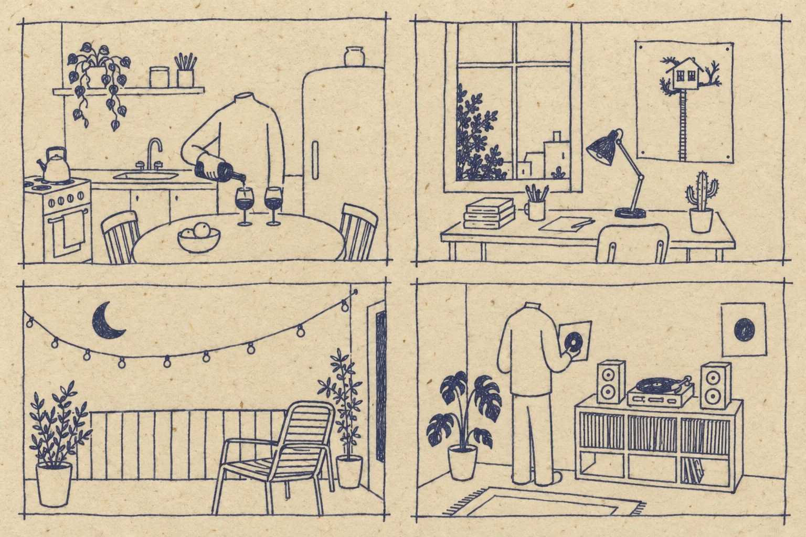

# Fineliner

A shadcn/ui component library drawn with one fine-liner on unbleached paper: a slow wobbly line, flattened perspective, no shading, and small pockets of solid ink where the eye should land. Its signature is seeded drawings: everyday objects, rooms and people drawn by a pen engine, each one different and the same on every render. The style is called Naïve Indie Line, after the natural-wine label it came from.



**Status:** v0.1, live at [naiveindieline.com](https://naiveindieline.com). All of shadcn/ui's parts (64, keeping shadcn's names, props and `data-slot`s; `form` and `toast` are served by `field` and `sonner`), twelve parts of Fineliner's own (label cards, record sleeves, track lists, price tags, hand notes and more), seven blocks, a chart drawn by the pen through the exact data, the pen engine with 57 drawings, four scenes and four lettering faces, a theme studio, and Listening Room, a record shop built only from the kit.

## What is in it

- **The pen engine** (`pen`): framework-free TypeScript that draws objects, scenes, lettering and marks as SVG from a seed, the same in Node and in the browser. Three takes of each drawing give the line boil.
- **Drawings** (`drawing`): `<Drawing object="turntable" seed="…" />`, `<Lettering>`, `<PenMark>`, `<Circled>`.
- **Components**: every shadcn part on Base UI, drawn: steady fields, frames that run past their corners, ink pockets, marks the pen puts down, sheets with the cartoonist's shadow, tables ruled by hand, charts drawn through the data.
- **Extras and blocks**: Fineliner's own parts and whole sections (sign-in, settings, dashboard, pricing, article, empty states, hero).
- **Appearance**: paper (bond, recycled, kraft; day and night), five pens, a calm or lively hand, line boil, open or boxed containers, small-caps or typewriter labels, density; saved per visitor and set before paint.

## Install

Fineliner installs with the shadcn CLI from its own registry at [naiveindieline.com](https://naiveindieline.com), into your project's `src/fineliner`, where it is yours to change. Add the registry to `components.json`:

```json
{
  "registries": {
    "@fineliner": "https://naiveindieline.com/r/{name}.json"
  }
}
```

Then add everything, or one part at a time (each docs page has its command):

```sh
npx shadcn add @fineliner/fineliner
```

```sh
npx shadcn add @fineliner/record-sleeve
```

Make `src/fineliner/styles/fineliner.css` your Tailwind entry (`@import "./fineliner/styles/fineliner.css";`), render `<FinelinerDefs />` once near the top of the page (the shared wobble filters), and run `appearanceScript()` in the document head before paint so the paper and pen are right on the first frame. The install contract is tested: `npm run test:consumer` installs items into a fresh Vite app and a Next.js App Router app offline, and type-checks and builds both.

## Run the site

Requires Node.js 24 and npm 11.

```sh
npm ci
```

```sh
npm run dev
```

Open `http://127.0.0.1:4791`: the home page, the components and blocks (`/docs`), the drawing library and desk, the theme studio (`/studio`), the specimen and Listening Room (`/listening-room`). `npm run build` writes the static site, the registry (`public/r`) and the share images to `dist`.

Checks: `typecheck`, `lint`, `format:check`, `build`, `check:contrast` (every pen on every textured stock, day and night), `registry` and `registry:check`, `test:consumer`. `npm run build:textures` regenerates the paper.

## Documents

| Document                                             | What it owns                                                                  |
| ---------------------------------------------------- | ----------------------------------------------------------------------------- |
| [Plan](docs/plan.md)                                 | Goals, decisions, phases, progress, risks, open questions                     |
| [Style brief](docs/style.md)                         | The style's rules, paper, pens, voices, the line, motion, drawings, lettering |
| [Architecture](docs/architecture.md)                 | The pen engine, takes, rendering, the registry, the theme runtime             |
| [Primitives](docs/primitives.md)                     | How each shadcn part is treated                                               |
| [Extras and blocks](docs/extras.md)                  | Fineliner's own parts, the blocks, the studio and the home page               |
| [Quality](docs/quality.md)                           | The accessibility and performance contract, and where the kit stands          |
| [Accessibility review](docs/accessibility-review.md) | The v0.1 review: what was checked, fixed and left                             |
| [Changelog](CHANGELOG.md)                            | What each release shipped                                                     |
| [AGENTS.md](AGENTS.md)                               | Working instructions for coding agents                                        |

Fineliner repeats [Patina UI](https://github.com/ossianravn/patina-ui)'s logic in a new style. The images in `docs/style/explorations/` were generated with gpt-image as direction for the drawings; the kit ships none of them. The static prototype the style was agreed on stays in `specimen/` as a reference.

## License

Code, art and generated textures: [MIT](LICENSE). The fonts (Newsreader, Courier Prime, Gaegu) are under the SIL Open Font License, shipped with their Fontsource packages.
